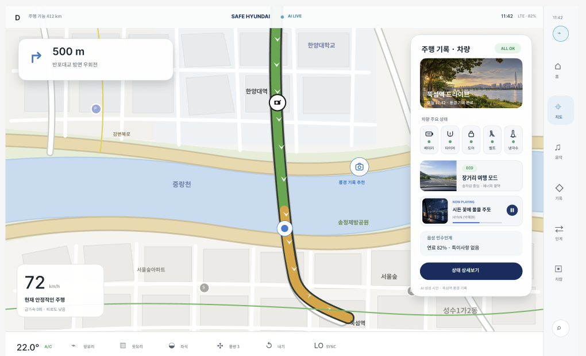
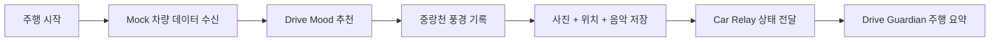
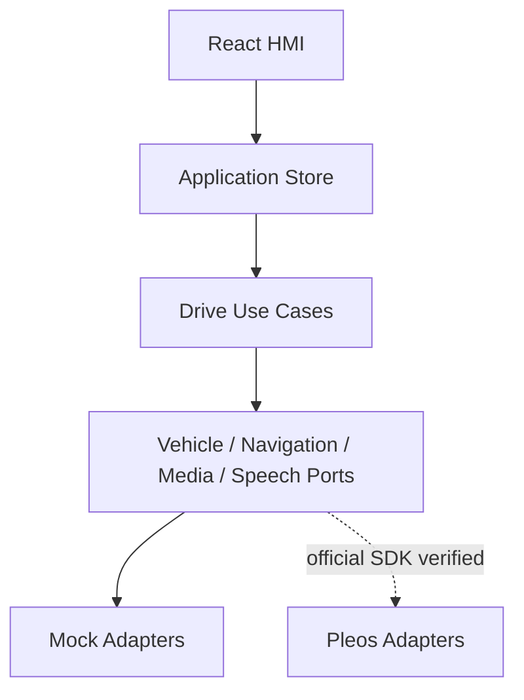

<div align="center">

# SafeHyundai

### AI 기반 차량 상황 인식 및 맞춤형 운전 경험 서비스

[](#프로젝트-상태)
[](#core-experiences)
[](#구현-전략)
[](#공개-저장소-정책)

운전 중 흩어지는 음악, 풍경, 차량 상태와 인수인계 정보를<br>
하나의 주행 맥락으로 연결하는 차량용 앱 프로토타입입니다.

[Figma Prototype](https://www.figma.com/design/NldILDcL7eysFDbFqFwTIz?node-id=16-2) · [Implementation Plan](docs/IMPLEMENTATION_PLAN.md) · [Demo Scenarios](docs/DEMO_SCENARIOS.md) · [Feature Feasibility](docs/FEATURE_FEASIBILITY.md)

</div>



> 이 저장소는 실제 차량 제어 제품이 아니라 **앱 시연용 프로토타입의 설계·구현 계획 저장소**입니다. 현재 화면과 사용자 흐름은 구현 가능하며, 실차 데이터 연동 범위는 공식 Pleos Connect SDK/API 권한을 확인한 후 확정합니다.

## Why SafeHyundai?

운전자에게 필요한 정보는 이미 많지만 서로 분리되어 있습니다.

- 음악 추천은 현재 주행 상황을 충분히 반영하지 못합니다.
- 여행 중 촬영한 사진은 위치와 당시 음악이 분리되어 남습니다.
- 가족 차량의 상태는 구두나 메신저로 전달되어 누락되기 쉽습니다.
- 주행 피로와 반복되는 운전 패턴은 운전 후에도 확인하기 어렵습니다.

SafeHyundai는 차량 데이터와 사용자의 경험을 연결해 **운전 중 조작은 줄이고, 운전 전후의 정보 가치는 높이는 것**을 목표로 합니다.

## Core Experiences

| 기능 | 사용자 경험 | 프로토타입 구현 방식 |
|---|---|---|
| **Drive Mood** | 주행 상황에 맞는 음악을 한 번에 추천 | 주행 시간·목적지·날씨·선호를 사용한 설명 가능한 규칙 엔진 |
| **Drive Memory** | 풍경, 위치, 음악을 하나의 여행 기록으로 저장 | 풍경 기록 버튼과 로컬 사진을 이용한 타임라인 생성 |
| **Car Relay** | 다음 운전자에게 차량 상태를 빠짐없이 전달 | 음성 대본 분류와 모의 차량 경고 데이터를 결합한 인수인계 카드 |
| **Drive Guardian** | 운전 중 방해를 줄이고 종료 후 패턴을 확인 | 급가속·급감속·주행시간 fixture를 분석한 사후 요약 |

## Prototype Demo Flow



1. 한양대역 인근에서 뚝섬역 방향의 시뮬레이션 주행을 시작합니다.
2. 장거리 주행과 여행 목적지를 근거로 음악을 추천합니다.
3. 중랑천 구간에서 풍경 기록을 제안하고 당시 위치와 음악을 함께 저장합니다.
4. 타이어 상태와 음성 메모를 다음 운전자용 인수인계 카드로 변환합니다.
5. 주행 종료 후 운전 패턴과 휴식 권고를 요약합니다.

## 프로젝트 상태

| 단계 | 의미 | 현재 상태 |
|---|---|:---:|
| `DESIGN` | Figma HMI와 주요 UI 상태 정의 | ✅ |
| `PLANNED` | 데이터 계약, 아키텍처, 작업·검증 기준 정의 | ✅ |
| `DEMO` | 모의 데이터로 전체 시나리오 실행 | ⏳ |
| `INTEGRATED` | 공식 SDK/API 연동 검증 | ⏳ |

현재 저장소는 **DESIGN + PLANNED** 단계입니다. 구현되지 않은 기능을 실차 연동이 끝난 것처럼 표현하지 않습니다.

## 구현 전략

### 1. Demo First

심사 환경의 네트워크나 API 상태에 영향을 받지 않도록 지도, 차량 신호, 날씨와 음악 메타데이터를 로컬 시나리오로 재현합니다.

### 2. Ports & Adapters

화면은 SDK를 직접 호출하지 않습니다. `VehicleDataPort`, `NavigationPort`, `MediaPort`, `SpeechPort`를 통해 데이터를 받고, 프로토타입의 `Mock Adapter`를 추후 `Pleos Adapter`로 교체합니다.



### 3. Explainable Rules Before ML

초기 추천·분류는 규칙 기반으로 구현합니다. 화면에 `장거리 주행 48분 + 여행 목적지`처럼 근거를 표시해 결과를 검증할 수 있게 하고, 충분한 데이터가 확보된 뒤 개인화 모델로 확장합니다.

## 구현 가능한 범위

### 바로 구현 가능

- 로컬 벡터 지도와 고정 경로 이동 애니메이션
- 속도·주행시간·경고 상태가 변하는 시나리오 러너
- 설명 가능한 음악 추천 및 실제 앨범 UI
- 풍경 사진·위치·재생 곡을 묶는 Drive Memory 카드
- 음성 대본을 타이어·배터리·정비 항목으로 분류하는 Car Relay
- 주행 종료 후 Guardian 요약과 휴식 제안
- IndexedDB 기반 로컬 기록 저장
- 오프라인 시연 및 GitHub Pages 배포

### 공식 SDK 확인 후 구현

- 실시간 속도·기어·배터리·TPMS 수신
- 실제 내비게이션 목적지와 ETA 연동
- 차량 시스템 미디어 재생 제어
- 운전자 계정 및 공유 차량 동기화
- 서로 다른 기기 간 인수인계 전송

세부 입력값, 기술 선택과 완료 조건은 [기능 구현 가능성 문서](docs/FEATURE_FEASIBILITY.md)에 정리했습니다.

## 권장 기술 스택

| 영역 | 선택 | 이유 |
|---|---|---|
| UI | React + TypeScript + Vite | 빠른 HMI 프로토타이핑과 타입 안전성 |
| State | Zustand | 시나리오·패널 상태를 작게 유지 |
| Map | Local SVG → MapLibre/Official SDK | 오프라인 데모 안정성과 향후 교체 가능성 |
| Storage | IndexedDB | 사진 메타데이터와 주행 기록의 로컬 저장 |
| Speech | Demo Script → Web Speech/Official STT | 시연 실패를 방지하는 단계적 접근 |
| Test | Vitest + Testing Library + Playwright | 규칙, UI, 전체 시연 흐름 검증 |
| Package | PWA → Capacitor | 웹 데모 이후 Android 패키징 가능 |

## 3-Day MVP Roadmap

| 일정 | 목표 | 결과물 |
|---|---|---|
| Day 1 | HMI 프레임, 지도, 상태 스토어, 시나리오 러너 | 이동하는 경로와 차량 상태 |
| Day 2 | Drive Mood, Memory, Relay 연결 | 우측 패널의 핵심 상호작용 |
| Day 3 | Guardian, 테스트, 배포, 영상 | 재현 가능한 URL과 90초 시연 영상 |

## Repository Guide

```text
safehyundai-prototype/
├─ assets/                       # 공개 가능한 프로토타입 이미지
├─ docs/
│  ├─ ARCHITECTURE.md            # 포트/어댑터 구조와 데이터 계약
│  ├─ DEMO_SCENARIOS.md          # 3개 심사 시연 흐름
│  ├─ FEATURE_FEASIBILITY.md      # 기능별 구현 방법과 완료 기준
│  ├─ IMPLEMENTATION_PLAN.md      # 전체 개발 계획
│  └─ PLEOS_INTEGRATION_MATRIX.md # 공식 연동 확인 항목
├─ tasks/
│  ├─ CURRENT.md                 # 역할 기반 현재 스프린트
│  └─ DEFINITION_OF_DONE.md       # 공통 완료 기준
├─ .env.example
└─ README.md
```

## Reference Approach

유사 프로젝트에서 검증된 구조를 다음과 같이 적용했습니다.

- 데이터 수집과 UI/분석을 분리하는 어댑터 구조
- 실제 데이터가 없어도 개발 가능한 deterministic fixture
- 로드맵, 현재 작업, 완료 기준을 분리한 작업 관리
- 프로토타입과 실차 연동 단계를 명확히 구분하는 상태 표시
- 개인정보와 원본 데이터가 저장소에 들어오지 않는 공개 저장소 정책

## 공개 저장소 정책

- 신청서 원본, 전화번호, 이메일, 학번, 개인 위치 기록을 커밋하지 않습니다.
- 팀원은 실명 대신 `Planning`, `App`, `Data`, `Design`, `QA` 역할로 표시합니다.
- 음원 파일은 배포하지 않고 제목·아티스트·허용된 이미지 메타데이터만 사용합니다.
- 실제 음성·사진은 동의를 받은 테스트 자산 또는 공개 가능한 샘플만 사용합니다.
- 비밀키는 `.env`에 저장하고 `.env.example`에는 변수 이름만 남깁니다.

## Documents

- [구체적인 구현 계획](docs/IMPLEMENTATION_PLAN.md)
- [시스템 아키텍처](docs/ARCHITECTURE.md)
- [기능별 구현 가능성](docs/FEATURE_FEASIBILITY.md)
- [심사 시연 시나리오](docs/DEMO_SCENARIOS.md)
- [Pleos 연동 확인표](docs/PLEOS_INTEGRATION_MATRIX.md)
- [팀 작업 방식](tasks/README.md)
- [완료 기준](tasks/DEFINITION_OF_DONE.md)

---

<div align="center">

**SafeHyundai — Drive context, remembered safely.**

</div>

