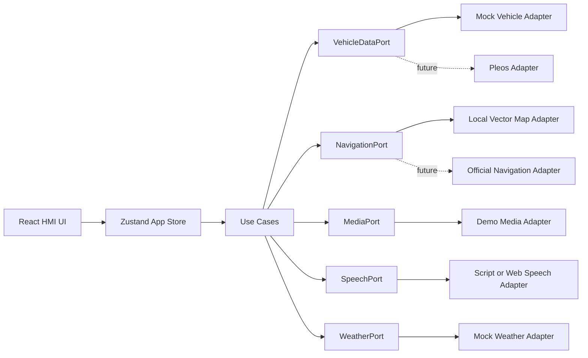

# Architecture

## 1. 구조 선택

프로토타입은 **단일 프런트엔드 + 포트/어댑터** 구조를 사용합니다. 초기에는 서버를 두지 않아 팀이 UI와 시연 흐름에 집중하고, 실제 Pleos 또는 공유 기능이 필요할 때만 백엔드를 추가합니다.



## 2. 권장 디렉터리

```text
apps/hmi/src/
  app/
  components/
  features/drive-mood/
  features/drive-memory/
  features/car-relay/
  features/drive-guardian/
  ports/
  adapters/mock/
  adapters/pleos/
  scenarios/
  stores/
  styles/
packages/vehicle-contracts/
packages/mock-scenarios/
docs/
tasks/
```

## 3. 포트 계약

```ts
interface VehicleDataPort {
  getSnapshot(): Promise<VehicleSnapshot>;
  subscribe(listener: (value: VehicleSnapshot) => void): () => void;
}

interface NavigationPort {
  getCurrentRoute(): Promise<RouteSnapshot>;
  subscribePosition(listener: (value: Position) => void): () => void;
}

interface MediaPort {
  getNowPlaying(): Promise<Track | null>;
  play(trackId: string): Promise<void>;
  pause(): Promise<void>;
}

interface SpeechPort {
  transcribe(input: Blob | DemoScript): Promise<Transcript>;
}
```

반환 타입은 앱 내부 모델로 표준화합니다. SDK 고유 타입을 UI까지 전달하지 않습니다.

## 4. 시나리오 러너

모든 시연은 동일한 시간축 이벤트 형식을 사용합니다.

```json
{
  "id": "tukseom-weekend-drive",
  "title": "뚝섬 장거리 여행",
  "durationSec": 90,
  "events": [
    { "atSec": 0, "type": "TRIP_STARTED" },
    { "atSec": 8, "type": "MOOD_SELECTED", "mode": "weekend-drive" },
    { "atSec": 24, "type": "SCENIC_POINT", "asset": "tukseom-sunset.jpg" },
    { "atSec": 48, "type": "VOICE_RELAY_SAVED", "script": "tire-pressure-low" },
    { "atSec": 75, "type": "TRIP_ENDED" }
  ]
}
```

개발자 모드에서는 재생, 일시정지, 10초 이동, 초기화를 지원합니다. 발표자가 원하는 화면을 즉시 재현하기 위한 기능입니다.

## 5. 상태와 우선순위

```text
critical vehicle warning
> handoff requiring confirmation
> rest recommendation
> scenic capture confirmation
> music recommendation
> default vehicle state
```

차량 주의 알림이 풍경 카드보다 높은 우선순위를 갖습니다. 운전 중에는 아이콘과 한 줄 요약만 표시하며 상세 내용은 정차 상태에서 엽니다.

## 6. 백엔드 도입 기준

다음 중 하나가 필요해질 때만 작은 FastAPI API 또는 Supabase를 추가합니다.

- 서로 다른 기기/계정 간 Car Relay 전달
- 여행 앨범 공유 링크
- 장기간 개인화 데이터 저장
- 서버 기반 STT 또는 추천 모델

## 7. 안전과 개인정보

- 주행 중 텍스트 입력 금지
- 경고등은 제조사 의미를 임의로 재해석하지 않음
- 음성/위치/사진은 각각 별도 동의와 삭제 기능 고려
- 실제 위치와 음성은 저장소와 테스트 fixture에 포함하지 않음
- “진단”, “사고 예측” 대신 “상태 안내”, “주행 습관 요약” 표현 사용

